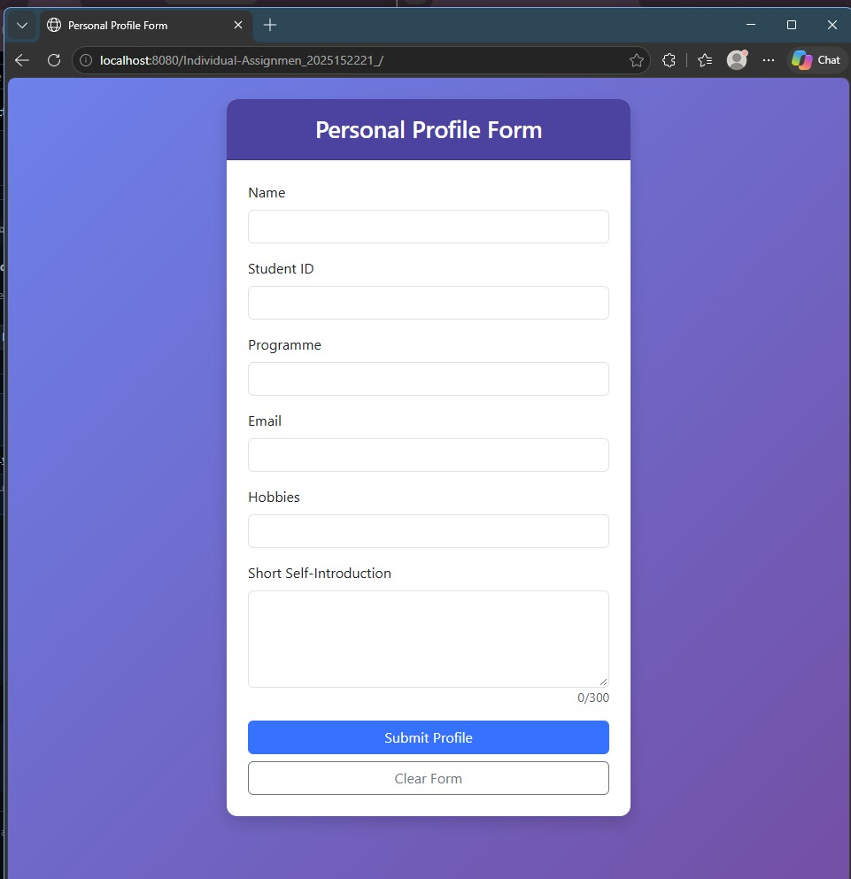
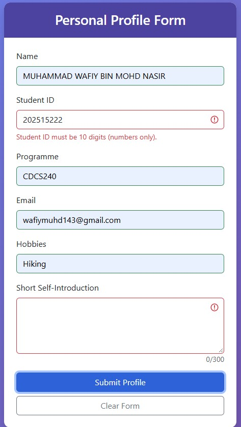
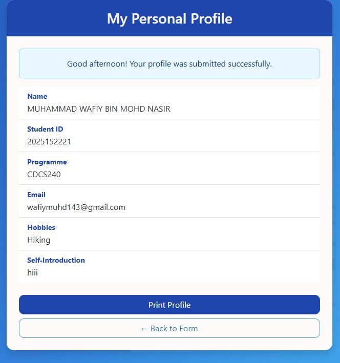

# CSC584 Individual Assignment 

## Personal Profile Web Application

This is my individual assignment for CSC584. It is a simple web application that collects personal profile information using an HTML form, sends it to a Servlet using HTTP POST, and shows the information on a JSP page.

## Technologies Used
- HTML
- CSS
- Bootstrap
- JavaScript
- Java Servlet
- JSP
- NetBeans IDE 8.2
- GlassFish Server 4.1.1

## How to Run
1. Install JDK 8 and NetBeans 8.2.
2. Download or clone this repository.
3. Open NetBeans and go to File > Open Project, then select the project folder.
4. Right-click the project and click Clean and Build.
5. Right-click the project and click Run.
6. The browser will open the form. Fill in the information and click Submit.
7. The profile page will show the information.

Note: Internet is needed because Bootstrap is loaded from a CDN.

## Screenshots

Form:

Validation:

Result:

## Author
- Name: Muhammad Wafiy Bin Mohd Nasir
- Student ID: 2025152221
- Programme: CDCS240
- Course: CSC584
- Group: CS2404B
